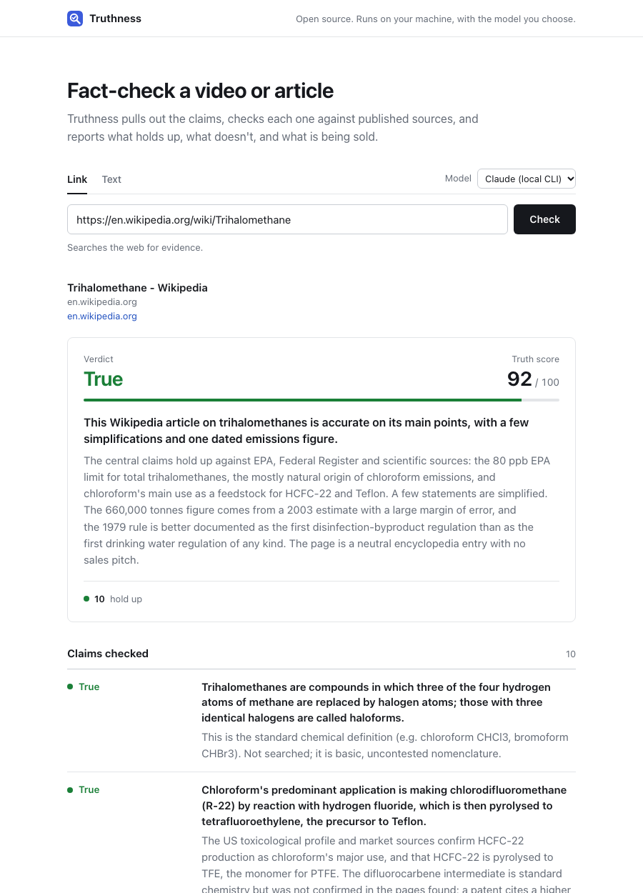

# Truthness

Fact-check a video or a web page before you believe it.

Truthness reads a YouTube video or a web page, pulls out the factual claims, checks each one against published sources with the AI model **you** choose, and tells you what holds up, what doesn't, and what is being sold. It runs on your own machine: no account, no hosted service.



**[Quick start](#quick-start)** · [Why this exists](#why-this-exists) · [Choosing models](#choosing-models) · [How to read a verdict](#how-to-read-a-verdict)

## Why this exists

### It started with a 60-second video

A short video opens with a man in his bathroom telling you that your shower water is toxic. You are, he says, bathing in more chlorine than a public swimming pool. The chlorine reacts into chemicals that enter your blood, damage your liver and kidneys, and probably cause cancer, and your city isn't telling you. Then, in the last ten seconds, the solution appears: a shower filter, "number one rated", link below.

It is convincing. He is calm, he cites real chemical names, and some of what he says is true: chlorinated water does contain those byproducts, and a shower does raise their level in your blood. But checked against the sources, the picture falls apart. Tap water is usually *less* chlorinated than a pool. The harms come from studies at doses far above what regulated tap water delivers. The "hidden" chemicals have been regulated and publicly reported for decades. And an independent test found the filter barely removes the very chemicals the video frightens you about. The video is a paid advertisement.

Working that out by hand means an hour of searching and reading. The video takes one minute to watch, and the next one starts automatically.

### This is how most misinformation works now

Outright lies are easy to dismiss. What works is the half-truth: real facts, arranged to leave a false impression. A real study, quoted without the dose. A real risk, without how small it is. A real number, without what it is compared to. Each sentence survives a fact-check on its own; the conclusion you are led to does not.

This is not an accident, it is a business model:

- **Attention is the product.** Platforms pay for and promote whatever keeps people watching, and fear, outrage and surprise keep people watching. A study of about 126,000 news stories on Twitter found that false stories reached people faster and spread further than true ones, and that people, not bots, were doing the sharing ([Vosoughi, Roy & Aral, *Science*, 2018](https://www.science.org/doi/10.1126/science.aap9559)).
- **Fear sells.** Much of the most alarming content about health, money and parenting ends with something to buy: a supplement, a filter, a course, a coin. The alarm is the sales pitch.
- **Making a claim is cheap; checking it is not.** Anyone can film a confident claim in a minute. Checking it means finding the primary source, reading it, and understanding what it does and does not say. Almost nobody has the time, so almost nobody does it.
- **It looks like expertise.** A steady voice, a lab coat, a chart and the phrase "studies show" are enough. On a phone, at speed, a careful scientist and a salesperson are hard to tell apart.

The cost is real. People spend money on things that do nothing, skip treatments that work, and worry about the wrong risks. They also forward it to family, in good faith, because it sounded true.

### What Truthness does about it

Truthness does the hour of checking for you, at the moment you are watching.

1. **It reads what was actually said.** The captions of a video or the text of a page, with timestamps.
2. **It separates the claims.** Each checkable statement is pulled out on its own, so one true fact cannot carry three false ones.
3. **It looks for evidence.** The model searches the web and links the sources it used, so you can open them yourself.
4. **It judges the impression as well as the sentences.** "Misleading" is a verdict of its own: the facts are largely real, the conclusion is not.
5. **It follows the money.** It tells you what is being sold, whether the content is sponsored, and which persuasion techniques are in use: fear, false urgency, borrowed authority, cherry-picked numbers.
6. **It says what was left out.** The dose, the comparison, the regulation that already exists.

For the shower video, that is a verdict of **Misleading, 42 out of 100**, with nine claims checked and the sources for each.

### Why it is open and runs on your machine

A fact-checker that asks for blind trust would be the same problem again. So:

- **You choose the model.** Claude, Gemini, a local model, or anything else; you can run the same content through two of them and compare.
- **Everything is inspectable.** The prompt, the code and the sources behind every verdict are open. If a verdict is wrong, you can see why.
- **Nobody is in the middle.** There is no company server deciding what is true, collecting what you check, or able to be pressured into changing an answer.

Truthness is not an oracle. AI models make mistakes, and a verdict is a starting point for your own judgment, not a ruling. The aim is modest: make checking as cheap as claiming, so that the next time something sounds alarming you can find out in a minute whether it is true, before you believe it, buy it or share it.

## Quick start

You need one AI model. The easiest is the [Claude Code CLI](https://claude.com/claude-code): if `claude` is installed and logged in, there is nothing to configure. See [Example setups](#example-setups) for API keys and local models.

### 1. Download Truthness

Prebuilt binaries are on the [releases page](https://github.com/kuralmani/Truthness/releases/latest). Nothing else needs to be installed.

**macOS and Linux** — pick the line for your machine:

```sh
V=v0.1.0
T=aarch64-apple-darwin        # Mac with Apple Silicon
# T=x86_64-apple-darwin       # Mac with Intel
# T=x86_64-unknown-linux-gnu  # Linux

curl -fsSL "https://github.com/kuralmani/Truthness/releases/download/$V/truthness-$V-$T.tar.gz" | tar xz
cd "truthness-$V-$T"
./truthness
```

**Windows** — download `truthness-v0.1.0-x86_64-pc-windows-msvc.zip` from the releases page, unzip it, and run `truthness.exe` from that folder.

The binaries are not code-signed. If you download the macOS archive with a browser instead of `curl`, macOS will block it until you run `xattr -d com.apple.quarantine truthness`; Windows may show a SmartScreen prompt (**More info** → **Run anyway**).

### 2. Open it

Go to <http://localhost:8787>, paste a link and press **Check**. A check with web search usually takes one to two minutes; results are cached for a week.

### Build from source instead

With [Rust](https://rustup.rs) installed:

```sh
curl -fsSL https://raw.githubusercontent.com/kuralmani/Truthness/main/install.sh | sh
truthness
```

or clone the repository and run `cargo run --release`.

### Install the browser extension (Chrome or Edge)

1. Download [truthness-extension.zip](https://github.com/kuralmani/Truthness/releases/latest/download/truthness-extension.zip) and unzip it somewhere you will keep it. (If you cloned the repository, use its `extension` folder instead.)
2. Open `chrome://extensions` (or `edge://extensions`) and turn on **Developer mode**.
3. Click **Load unpacked** and choose that folder.

Keep the server running, then:

- on YouTube, open a video or Short and click **Check the facts** (bottom right);
- on any other page, click the Truthness toolbar icon;
- or select some text, right-click and choose **Fact-check … with Truthness**.

The extension talks to `http://localhost:8787` by default. Change the server and the model under the extension's **Options**.

### Example setups

| You have | Do this |
|---|---|
| Claude Code CLI | Nothing. Run `truthness` (`./truthness` from the downloaded folder). |
| An Anthropic API key | `ANTHROPIC_API_KEY=… truthness` |
| A Gemini API key | `GEMINI_API_KEY=… truthness` |
| Ollama or another local model | Copy `truthness.example.toml` to `truthness.toml`, uncomment the `[providers.ollama]` block, run `truthness` |
| Another CLI (Gemini CLI, …) | Same file, the `type = "command"` block |

`truthness.toml` is read from the folder you start the server in; pass another path as the first argument (`truthness /path/to/truthness.toml`) or set `TRUTHNESS_CONFIG`.

Try the API directly:

```sh
curl -s localhost:8787/api/check -H 'Content-Type: application/json' \
  -d '{"url": "https://en.wikipedia.org/wiki/Trihalomethane"}'
# {"id":"…"}   then poll:  curl -s localhost:8787/api/check/<id>
```

## What is in the repository

| Part | Where | What it is |
|---|---|---|
| Server | `src/` | Rust (axum). Extracts content, runs the model, caches results, serves the website. |
| Website | `web/` | Paste a link or text, get a verdict. No build step. |
| Browser extension | `extension/` | Chrome / Edge (Manifest V3). A "Check the facts" button on YouTube, and a toolbar button + right-click menu on every other page. |

## Choosing models

Copy `truthness.example.toml` to `truthness.toml`. Each `[providers.<name>]` block adds a model to the picker on the website and in the extension.

| `type` | Use it for | Searches the web? |
|---|---|---|
| `claude-cli` | Claude Code CLI with your existing login | yes |
| `anthropic` | Anthropic API (`ANTHROPIC_API_KEY`) | yes |
| `gemini` | Gemini API (`GEMINI_API_KEY`); can also watch YouTube videos directly | yes |
| `openai-compatible` | OpenAI, Ollama, LM Studio, vLLM, OpenRouter, … | no |
| `command` | Any CLI that reads a prompt on stdin and prints an answer | you say |

Models without web search can only answer from memory. Truthness tells them so, and labels their verdicts accordingly in the UI. Prefer a model that can search.

API keys are read from environment variables, never from the config file.

### Adding a provider in code

Implement the `Provider` trait in `src/providers/mod.rs` (one `analyze` method that takes a system prompt and a user prompt and returns the model's text), add a variant to `ProviderConfig` in `src/config.rs`, and register it in `providers::build`.

## API

```
POST /api/check        {"url": "...", "text": "...", "provider": "...", "force": false}  → {"id": "..."}
GET  /api/check/{id}   → {"status": "queued|extracting|analyzing|done|error", "message", "result", "error"}
GET  /api/providers    → {"providers": [...], "default": "..."}
```

Send `url`, `text`, or both (the extension sends both for ordinary pages so that it works behind logins).

## How to read a verdict

Truthness is a tool for thinking, not an oracle.

- The verdict is an AI model's assessment. Models make mistakes, miss recent events and can misread a source. Open the linked sources before you share a verdict or act on it.
- "Can't verify" is a real answer. The model is told to say so rather than guess.
- "Misleading" means the individual facts are largely real but the impression they are arranged to create is not. This is how most health and money content online misleads.
- Videos are judged on their captions. Auto-generated captions contain errors, and anything shown but not said is invisible to the model (unless you use a provider that watches the video, such as Gemini). If a video has no captions the result says so.

## Security and privacy notes

- **The content being checked is untrusted input.** The prompt tells the model to treat it as data, and the `claude-cli` provider is started with web search and web fetch as its only tools (no shell, no files, no MCP servers). A `command` provider gets whatever that command can do, so pick one accordingly.
- The server listens on `127.0.0.1` and sends no CORS headers, so other websites cannot use your browser to call it and spend your model quota. The extension calls it from its background worker.
- Fetching user-supplied URLs is restricted to public addresses (`allow_private_hosts = false`), checked on every redirect. This does not defend against DNS rebinding; put a real egress policy in front of a public deployment.
- The extension reads a page only when you ask it to. It sends the page text to the server you configured and nowhere else.
- **Before hosting this publicly**, add authentication or rate limiting in front of it: every check costs model usage.

## Known limits / ideas

- YouTube is the only video site with transcript support. TikTok, Instagram and X links are treated as ordinary pages, which usually yields little text. Audio transcription (e.g. Whisper) would fix this.
- YouTube changes its internals often; caption fetching (`src/extract.rs`) is the part most likely to need maintenance.
- Results live in a local file cache and jobs live in memory. A shared database and a public "already checked" index would let one check serve everyone.
- Running two different models and showing where they disagree would make verdicts more trustworthy.

## Development

```sh
cargo test                       # unit tests
./scripts/sync-extension.sh      # after editing web/render.js or web/verdict.css
./scripts/package-extension.sh   # builds truthness-extension.zip
```

In debug builds the website is read from `web/` on every request; release builds embed it in the binary.

## Contributing

Issues and pull requests are welcome, especially new providers, transcript support for more video sites, and fixes when YouTube changes. Please run `cargo test` before opening a pull request. Pushing a tag such as `v0.1.0` builds release binaries and the extension zip.

## License

[MIT](LICENSE)
